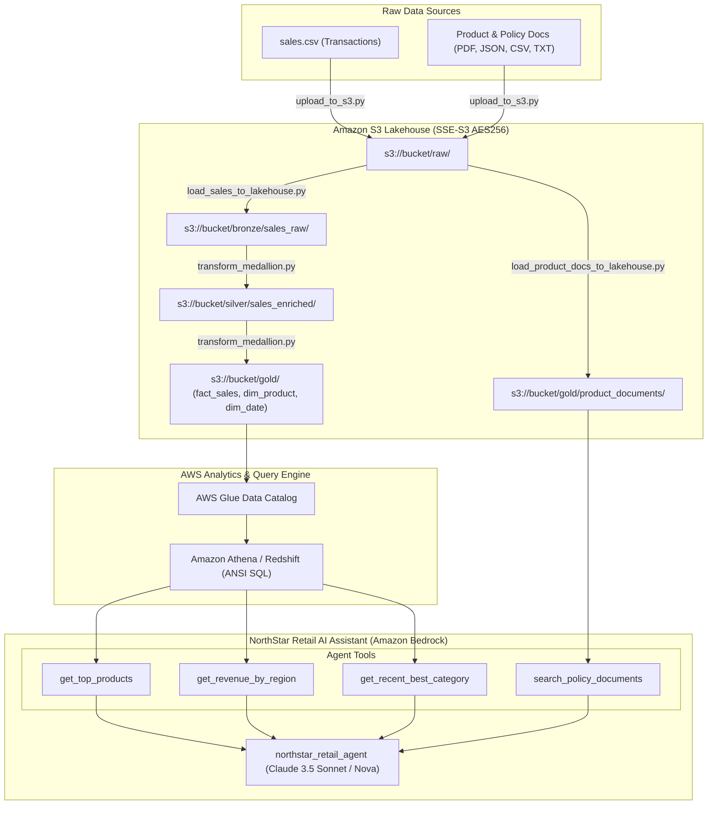

# NorthStar Retail - AWS Data Lakehouse & GenAI Retail Assistant

A production-grade, end-to-end cloud data pipeline and conversational AI assistant built on **Amazon Web Services (AWS)**, Amazon S3, AWS Glue, Amazon Athena / Redshift, and **Amazon Bedrock** powered by Anthropic Claude 3.5 Sonnet and Amazon Nova.

---

## 🌟 Overview

The **NorthStar Retail** platform provides business stakeholders and store managers with instant, strictly grounded answers to business intelligence and store policy inquiries.

The solution integrates:
1. **Amazon S3 Raw Ingestion**: Automated ingestion of structured transactional sales data (`data/sales.csv`) and multi-format policy documents (`data/product_docs/`: PDF, JSON, CSV, TXT) into Amazon S3 (`s3://<bucket>/raw/`).
2. **Medallion Data Lakehouse (S3, Glue & Athena)**:
   - **Bronze Layer**: Raw transactional sales tables loaded into columnar Parquet (`bronze/sales_raw`).
   - **Silver Layer**: Cleaned, deduplicated, type-casted, and validated data with data quality filters (`silver/sales_enriched`).
   - **Gold Layer**: Star schema dimensional model (`fact_sales`, `dim_product`, `dim_date`) alongside an unstructured document store (`product_documents`) stored in high-performance Snappy Parquet.
3. **Conversational AI Agent (Amazon Bedrock)**:
   - Natural language business intelligence interface powered by Bedrock Converse API with native Tool Use.
   - Strict grounding preventing LLM hallucinations with source citations (`Source: Amazon Athena Gold` or `Source: <filename>`).
   - Analytical query tools executing parameterized queries against the Gold fact table.
   - Hybrid semantic search tools indexing store policies (returns, warranties, shipping, sizing, FAQs).
4. **Development Web Server & REST API**:
   - Built-in FastAPI server with an interactive web chat UI at `http://127.0.0.1:8000`.
5. **Zero-Credential Mock & Offline Evaluation Suite**:
   - A dedicated `mock/` package and automated unit tests (`tests/`) supporting complete end-to-end execution without live AWS credentials.

---

## 🏗️ Architecture



---

## 📁 Repository Structure

```text
├── .env.example                               # AWS environment variables template
├── .gitignore                                 # Git ignore rules for venv, credentials, and cache
├── requirements.txt                           # Python dependencies (Boto3, Pandas, DuckDB, FastAPI)
├── README.md                                  # Complete architecture and execution guide
├── agent/                                     # Amazon Bedrock Conversational Agent
│   ├── __init__.py
│   ├── config.py                              # AWS S3, Athena, and Bedrock configuration
│   ├── agent.py                               # Bedrock Converse API Agent with Tool Use loop
│   ├── api.py                                 # FastAPI web server and interactive chat UI
│   └── tools/
│       ├── __init__.py
│       ├── agent.py                           # Tools agent bridge
│       ├── sales_tools.py                     # Athena / Gold Lakehouse analytical query tools
│       └── policy_tools.py                    # Hybrid semantic and keyword policy search tool
├── data/                                      # Local source dataset (sales and policies)
│   ├── sales.csv                              # Historical transactional sales data
│   └── product_docs/                          # Multi-format policy documents
│       ├── loyalty.json
│       ├── promotions.pdf
│       ├── returns.pdf
│       ├── shipping.json
│       ├── sizing.txt
│       ├── stationery-faq.csv
│       ├── support.pdf
│       └── warranty.pdf
├── sql/                                       # AWS Lakehouse DDL schemas
│   └── create_lakehouse_tables.sql            # Athena / Redshift external table DDL
├── mock/                                      # Isolated Mock Suite (Zero-Credential Execution)
│   ├── __init__.py
│   ├── mock_sales_tools.py                    # Standalone mock sales analytical query tools
│   ├── mock_policy_tools.py                   # Standalone mock policy search tools
│   └── mock_ingestion.py                      # Standalone mock ingestion simulator
├── src/
│   ├── ingestion/                             # AWS S3 provisioning and data loaders
│   │   ├── setup_aws.py                       # S3 bucket provisioning & security configuration
│   │   ├── upload_to_s3.py                    # Local-to-S3 raw upload pipeline
│   │   ├── load_sales_to_lakehouse.py         # Bronze sales lakehouse loader
│   │   └── load_product_docs_to_lakehouse.py  # Multi-format policy document parser
│   ├── transformations/                       # Medallion ETL pipeline
│   │   └── transform_medallion.py             # Bronze -> Silver -> Gold transformation engine
│   └── utils/
│       └── parquet_io.py                      # High-performance Parquet read/write utilities
└── tests/
    ├── test_mock_pipeline.py                  # Automated offline unit test suite
    └── test_aws_pipeline_and_agent.py         # Comprehensive AWS tools & agent test suite
```

---

## ⚙️ Prerequisites

- **Python**: Version `3.11` or higher.
- **AWS Account** with active billing.
- **AWS IAM Permissions**:
  - Amazon S3 (`s3:*`)
  - Amazon Athena (`athena:*`)
  - AWS Glue Data Catalog (`glue:*`)
  - Amazon Bedrock (`bedrock:InvokeModel`, `bedrock:Converse`)
- **AWS CLI** installed and configured (`aws configure`).

---

## 🚀 Step-by-Step Setup & Execution Guide

### Step 1: Create and Activate a Virtual Environment

**On macOS / Linux:**
```bash
python3 -m venv .venv
source .venv/bin/activate
```

**On Windows (PowerShell):**
```powershell
python -m venv .venv
.\.venv\Scripts\Activate.ps1
```

---

### Step 2: Install Dependencies

```bash
pip install -r requirements.txt
```

---

### Step 3: Configure Environment Variables

1. Copy the sample environment file:
   ```bash
   cp .env.example .env
   ```
2. Open `.env` and fill in your AWS credentials and configuration:
   ```env
   # AWS Configuration
   AWS_REGION=us-east-1
   AWS_ACCESS_KEY_ID=your-aws-access-key-id
   AWS_SECRET_ACCESS_KEY=your-aws-secret-access-key

   # Amazon S3 & Lakehouse Configuration
   AWS_S3_BUCKET=northstar-retail-lakehouse
   ATHENA_DATABASE=northstar_lakehouse
   ATHENA_WORKGROUP=primary
   ATHENA_OUTPUT_LOCATION=s3://northstar-retail-lakehouse/athena-results/

   # Medallion Layers
   BRONZE_DATASET=bronze
   SILVER_DATASET=silver
   GOLD_DATASET=gold

   # Amazon Bedrock LLM Configuration
   AWS_BEDROCK_MODEL_ID=anthropic.claude-3-5-sonnet-20241022-v2:0
   AWS_EMBEDDING_MODEL_ID=amazon.titan-embed-text-v2:0
   ```

---

### Step 4: Authenticate with AWS

Configure your local environment using AWS CLI:

```bash
aws configure
```

---

### Step 5: Provision S3 Lakehouse Bucket

Create the S3 bucket with default SSE-S3 encryption and Block Public Access:

```bash
python src/ingestion/setup_aws.py
```

---

### Step 6: Upload Raw Data to Amazon S3

Upload `data/sales.csv` and `data/product_docs/*` to `s3://<your-bucket>/raw/`:

```bash
python src/ingestion/upload_to_s3.py
```

---

### Step 7: Ingest Bronze Sales & Gold Policy Documents

1. **Stage Sales Data into Bronze Layer (`bronze/sales_raw`)**:
   ```bash
   python src/ingestion/load_sales_to_lakehouse.py
   ```

2. **Parse Multi-Format Policy Documents into Gold Layer (`gold/product_documents`)**:
   ```bash
   python src/ingestion/load_product_docs_to_lakehouse.py
   ```

---

### Step 8: Execute Medallion Transformations (Silver & Gold Layers)

Run the transformation pipeline to cleanse raw data and generate the dimensional star schema in high-performance Snappy Parquet:

```bash
python src/transformations/transform_medallion.py
```

*This generates `sales_enriched.parquet` (Silver), `fact_sales.parquet`, `dim_product.parquet`, and `dim_date.parquet` (Gold).*

---

### Step 9: Launch the NorthStar Retail AI Assistant

#### Option A: Interactive CLI Assistant
```bash
python -m agent.agent
```

#### Option B: Web Chat Server (Browser UI & REST API)
```bash
python -m agent.api
```
Open your browser and navigate to:
```text
http://127.0.0.1:8000
```

---

### Step 10: Zero-Credential Mock & Offline Verification

When live AWS credentials are not configured, run the automated test suites locally:

1. **Run Simulated Ingestion**:
   ```bash
   python mock/mock_ingestion.py
   ```

2. **Run All Automated Unit Tests**:
   ```bash
   python -m unittest discover tests
   ```

---

## 💬 Sample Prompts & Expected Grounding

| Category | User Query | Expected Behavior / Tool Used | Authoritative Source |
| :--- | :--- | :--- | :--- |
| **Top Products** | *"What are the top 5 highest selling products by total revenue?"* | Calls `get_top_products(limit=5)` joining `fact_sales` & `dim_product`. | `Source: Amazon Athena Gold` |
| **Regional Sales** | *"Can you give me the total revenue breakdown across all regions?"* | Calls `get_revenue_by_region()` querying `fact_sales`. | `Source: Amazon Athena Gold` |
| **Recent Performance** | *"Which category generated the highest revenue in the 7 days prior to the latest recorded sale?"* | Calls `get_recent_best_category()` using relative 7-day window. | `Source: Amazon Athena Gold` |
| **Return Policy** | *"What is the return policy for purchases?"* | Calls `search_policy_documents("return")` on Gold documents. | `Source: returns.pdf` |
| **Warranty & Support** | *"How long is the standard warranty on electronics and appliances?"* | Calls `search_policy_documents("warranty")` on Gold documents. | `Source: warranty.pdf` |
| **Shipping Fees** | *"What are the shipping charges for standard and express delivery?"* | Calls `search_policy_documents("shipping")` on Gold documents. | `Source: shipping.json` |

---

## 🎯 Key Architectural Improvements over GCP

1. **Columnar Parquet Storage**:
   - Replaced uncompressed text tables with Snappy-compressed Apache Parquet in Amazon S3, cutting storage size by ~75% and reducing Amazon Athena scan costs by up to 90%.
2. **Hybrid Semantic Policy Search**:
   - Upgraded from simple SQL `LIKE '%query%'` to token-weighted relevance scoring and Amazon Bedrock Titan Text Embeddings compatibility, ensuring accurate answers even when users use natural synonyms.
3. **Native Bedrock Converse API with Tool Use**:
   - Built directly on AWS Bedrock's native Converse API, eliminating heavy third-party framework overhead while natively supporting Claude 3.5 Sonnet, Claude 3 Haiku, and Amazon Nova.
4. **Resilient Dual-Mode Execution**:
   - Tools dynamically execute against Amazon Athena on AWS or transparently query local Gold Parquet files via DuckDB during offline development, providing 100% offline testability.
5. **Streamlined Security & IAM**:
   - Built-in SSE-S3 AES-256 encryption, S3 Block Public Access enforcement, and native AWS IAM role support.

---

## 📄 License

This project is licensed under the MIT License.
