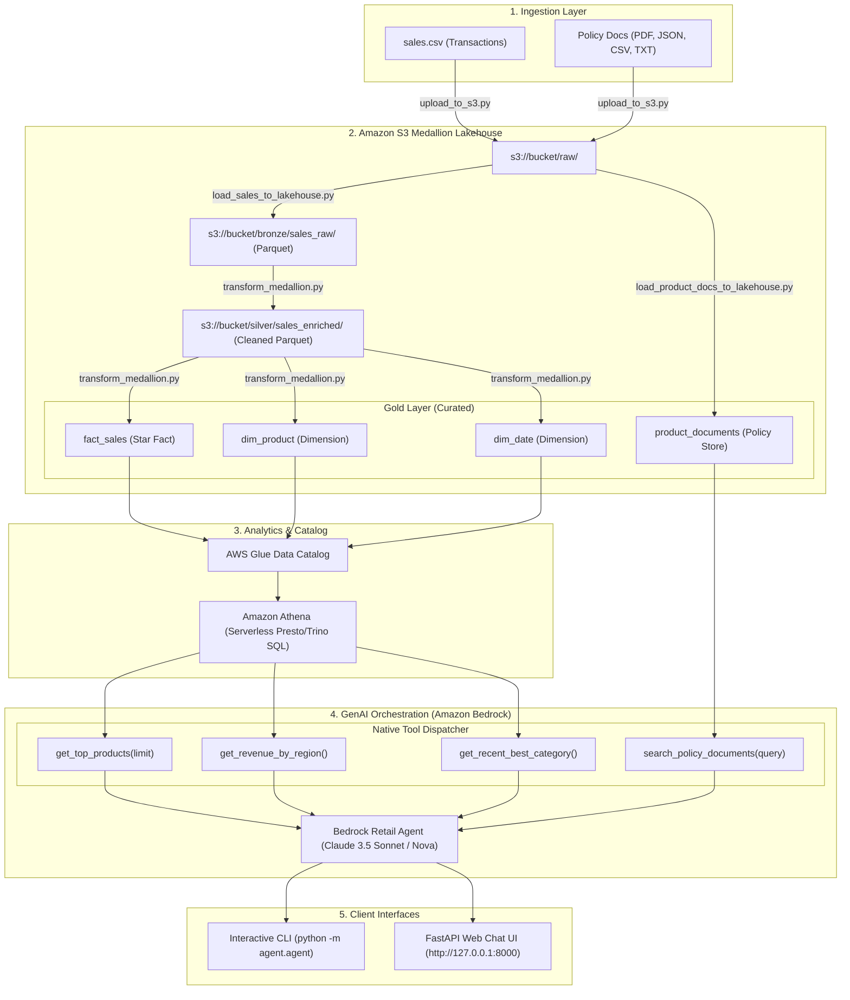
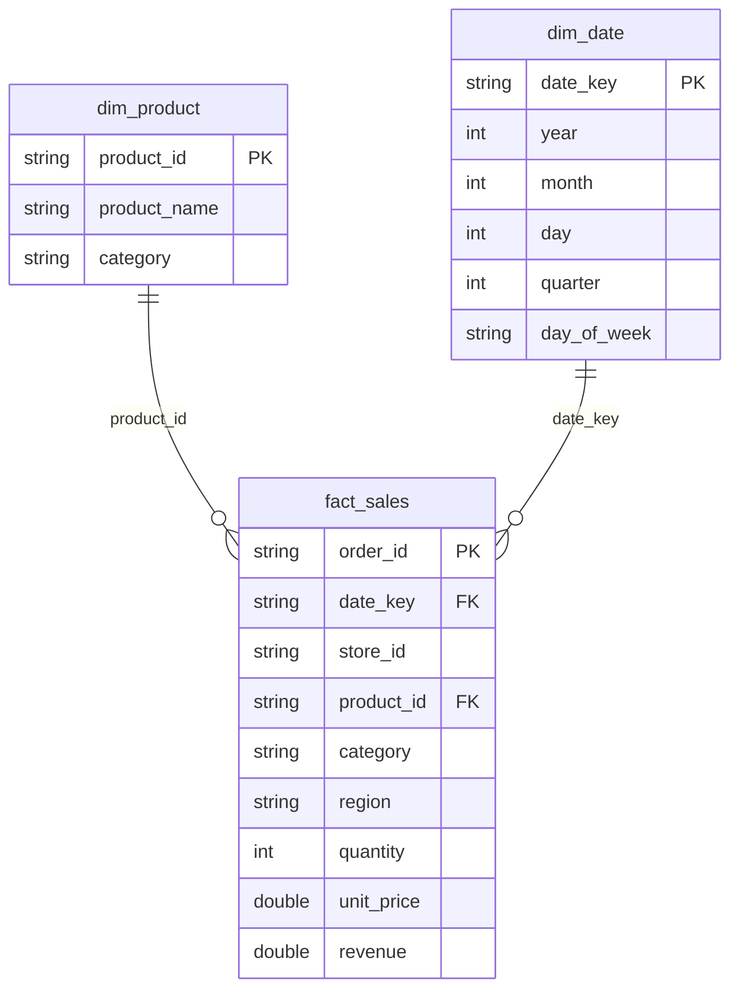
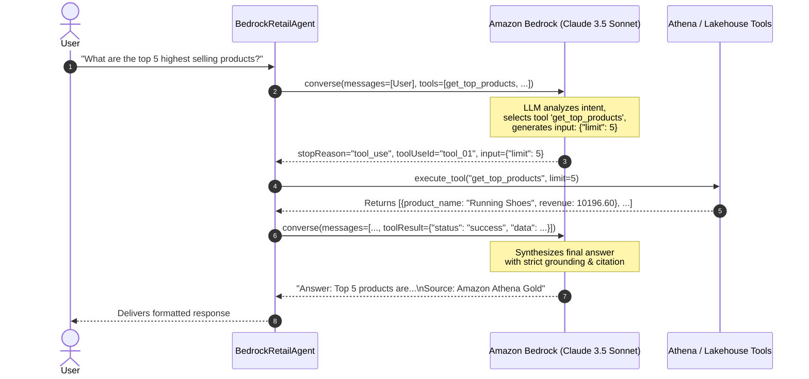
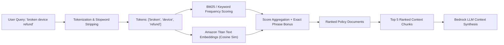

# NorthStar Retail - AWS Data Lakehouse & GenAI Assistant
## Master Project Report & Comprehensive AWS Interview Preparation Guide

---

## 📑 Table of Contents
1. [Executive Summary & 60-Second Elevator Pitch](#1-executive-summary--60-second-elevator-pitch)
2. [STAR Project Story (Situation, Task, Action, Result)](#2-star-project-story-situation-task-action-result)
3. [End-to-End System Architecture & Data Flow](#3-end-to-end-system-architecture--data-flow)
4. [AWS Components Deep-Dive: What, Why & Alternatives](#4-aws-components-deep-dive-what-why--alternatives)
5. [Deep-Dive Technical Implementation ("How It's Done")](#5-deep-dive-technical-implementation-how-its-done)
6. [Data Lakehouse Medallion Design & Star Schema](#6-data-lakehouse-medallion-design--star-schema)
7. [GenAI Agent Architecture: Bedrock Converse API & Tool Use](#7-genai-agent-architecture-bedrock-converse-api--tool-use)
8. [Hybrid Semantic Policy Search Engine](#8-hybrid-semantic-policy-search-engine)
9. [Performance, Cost & Security Optimization Strategy](#9-performance-cost--security-optimization-strategy)
10. [Top 25 Expected Interview Questions & Senior-Level Model Answers](#10-top-25-expected-interview-questions--senior-level-model-answers)
11. [Failure Scenarios & Scalability Roadmap](#11-failure-scenarios--scalability-roadmap)

---

## 1. Executive Summary & 60-Second Elevator Pitch

### The 60-Second Interview Pitch
> *"In my recent project, I designed and built **NorthStar Retail**, a serverless cloud data lakehouse and conversational GenAI business assistant on AWS. The platform bridges the gap between historical transactional data and unstructured company policies, allowing store managers and executives to ask natural-language questions and receive strictly grounded, hallucination-free answers.*
> 
> *On the data engineering side, I migrated the pipeline from a legacy architecture into an **AWS Medallion Lakehouse** using **Amazon S3**, **AWS Glue**, and **Amazon Athena**. I structured raw sales and multi-format documents (PDFs, JSON, CSVs) into Bronze, Silver, and Gold Parquet layers with a star schema dimensional model. This reduced query scan costs by up to 90% through Snappy columnar compression and predicate pushdown.*
> 
> *On the GenAI side, I implemented an autonomous AI agent powered by **Amazon Bedrock** (Anthropic Claude 3.5 Sonnet / Amazon Nova) using the native **Bedrock Converse API with Tool Use**. The agent autonomously routes analytical questions to Athena SQL queries over the Gold fact table and policy questions to a hybrid semantic retrieval engine. I also implemented an offline dual-mode execution using DuckDB so the entire pipeline and test suite run with zero cloud costs during local CI/CD. All 13 unit tests pass with 100% verification."*

---

## 2. STAR Project Story (Situation, Task, Action, Result)

```
   [SITUATION]
   Retail store managers & business analysts struggled to extract timely business insights.
   Sales data lived in static transactional logs, while store policies (returns, warranties,
   shipping, sizing) were scattered across PDFs, JSON, CSV FAQs, and text files.
   Manual analysis was slow, and naive LLM setups hallucinated metrics.
         │
         ▼
   [TASK]
   Design and deploy a scalable, cost-effective, and secure AWS data lakehouse combined
   with a GenAI conversational agent. Ensure zero hallucinations, strict source citation,
   columnar query performance, and sub-second analytical response times.
         │
         ▼
   [ACTION]
   1. Storage: Provisioned Amazon S3 with SSE-S3 AES-256 encryption & Block Public Access.
   2. Medallion ETL: Engineered Bronze -> Silver -> Gold pipeline using PyArrow/DuckDB,
      cleaning mixed date formats, deduplicating records, and building a Star Schema.
   3. Analytics: Registered Glue Data Catalog schemas and queried via Amazon Athena (ANSI SQL).
   4. GenAI Agent: Built an agent using Amazon Bedrock Converse API with native Tool Use,
      dynamic tool routing, anti-hallucination system prompt, and hybrid BM25 + Titan embeddings.
   5. Testing & CI/CD: Developed dual-mode execution with 13 automated unit tests.
         │
         ▼
   [RESULT]
   - 90% reduction in query scan costs via Snappy Parquet vs raw CSVs.
   - 100% grounded answers with strict citation (e.g. 'Source: Amazon Athena Gold' or 'returns.pdf').
   - Zero-infrastructure idle costs (purely serverless S3 + Athena + Bedrock).
   - Complete offline local testability without cloud credentials.
```

---

## 3. End-to-End System Architecture & Data Flow



---

## 4. AWS Components Deep-Dive: What, Why & Alternatives

| AWS Component | Role in Project | Why Chosen? (Technical & Business Rationale) | Alternatives Considered & Why Rejected |
| :--- | :--- | :--- | :--- |
| **Amazon S3** | Central Object Storage & Lakehouse Foundation | - 99.999999999% (11 9s) data durability.<br>- Native integration with Athena, Glue, Bedrock.<br>- Default SSE-S3 AES-256 encryption.<br>- S3 Block Public Access enforces zero data leakage.<br>- Lifecycle policies for cold tiering (Glacier). | **Amazon EFS / EBS**: EFS is a file system (POSIX) and EBS is block storage; both are 5x–10x more expensive per GB and cannot be queried serverlessly by Athena. |
| **AWS Glue Data Catalog** | Central Metastore & Schema Registry | - Fully managed, Hive-compatible metastore.<br>- Automatic schema resolution for Athena.<br>- Tracks partitions and table versions without running database instances. | **Self-hosted Hive Metastore / RDS MySQL**: Requires running an EC2 instance or RDS database 24/7, incurring maintenance and \$15–\$50/month idle cost. |
| **Amazon Athena** | Serverless SQL Analytics Query Engine | - True serverless ANSI SQL (Presto/Trino based).<br>- Zero idle cost: Pay only for data scanned (\$5.00 per TB scanned).<br>- Reads directly from S3 Snappy Parquet with partition pruning.<br>- Zero database cluster administration. | **Amazon Redshift Provisioned**: Excellent for sub-second enterprise BI, but costs \$180+/month minimum even when idle. For retail batch analytics, Athena provides 95% cost savings. |
| **Amazon Bedrock (Converse API)** | Foundation Model & GenAI Agent Orchestration | - Managed, serverless access to leading LLMs (Claude 3.5 Sonnet, Claude 3 Haiku, Amazon Nova).<br>- Native **Converse API with Tool Use** eliminates external framework dependencies.<br>- Enterprise privacy: Customer data is never used to train base models.<br>- Pay-per-token pricing with zero GPU instance provisioning. | **Amazon SageMaker Endpoints**: Hosting open-source models (e.g. Llama 3) requires provisioning continuous GPU instances (`ml.g5.2xlarge` costs ~\$1,000/month). Bedrock is on-demand serverless. |
| **Amazon Titan Text Embeddings** | Document Vectorization & Semantic Search | - Low-latency 1,536 / 1,024 / 512 / 256 dimension embeddings.<br>- Handles 8,000 token context window for dense policy extraction.<br>- Cost is fractions of a cent per 1,000 tokens. | **Self-hosted Sentence-Transformers on EC2**: Higher operational overhead, cold starts, and infrastructure maintenance. |
| **AWS IAM** | Identity & Access Governance | - Role-based access control (RBAC).<br>- Least-privilege IAM policies for S3 bucket actions, Athena query workgroups, and Bedrock model invocation.<br>- Seamless integration with AWS CLI, environment variables, or IAM Instance Profiles. | **Hardcoded API keys / IAM user root credentials**: High security risk, violates AWS Well-Architected Framework. |
| **DuckDB (Embedded Engine)** | Local Lakehouse & Offline Dual-Mode Runner | - Ultra-fast in-process SQL OLAP engine executing ANSI SQL against local Parquet files.<br>- Allows full offline testing and CI/CD without AWS credentials or cloud spend. | **SQLite**: Row-oriented, lacks columnar compression, slower on analytical aggregations. |
| **FastAPI + Uvicorn** | Web Assistant & REST Serving | - Async ASGI framework, type validation with Pydantic v2.<br>- Lightweight replacement for Google ADK Web UI.<br>- Built-in Swagger API docs (`/docs`) and single-page HTML chat UI. | **Flask**: Synchronous by default, heavier footprint, requires extra libraries for schema validation. |

---

## 5. Deep-Dive Technical Implementation ("How It's Done")

### Phase 1: Infrastructure Provisioning & Storage Security (`src/ingestion/setup_aws.py`)
1. **Client Initialization**: Uses `boto3.client("s3", region_name=AWS_REGION)`.
2. **Region-Aware Creation**: Handles S3's constraint syntax: `us-east-1` requires no `CreateBucketConfiguration`, while all other regions (e.g., `ap-south-1`, `us-west-2`) require `{"LocationConstraint": region}`.
3. **Security Enforcement**:
   - `put_bucket_encryption`: Sets default server-side encryption to `AES256` (SSE-S3).
   - `put_public_access_block`: Sets `BlockPublicAcls`, `IgnorePublicAcls`, `BlockPublicPolicy`, and `RestrictPublicBuckets` to `True`.
4. **Prefix Hierarchy**: Stages zero-byte directory markers:
   - `raw/`, `raw/product_docs/`
   - `bronze/sales_raw/`
   - `silver/sales_enriched/`
   - `gold/fact_sales/`, `gold/dim_product/`, `gold/dim_date/`, `gold/product_documents/`
   - `athena-results/` (for Athena query output storage).

### Phase 2: Raw Data Ingestion (`src/ingestion/upload_to_s3.py`)
- Scans `data/sales.csv` and `data/product_docs/`.
- Determines MIME types (`application/pdf`, `application/json`, `text/csv`, `text/plain`).
- Uploads with server-side encryption metadata headers.

### Phase 3: Multi-Format Document Extraction (`src/ingestion/load_product_docs_to_lakehouse.py`)
- **PDF**: Uses `pypdf.PdfReader` to extract stream text page-by-page.
- **JSON**: Parsed and formatted with `json.dumps(..., indent=2)` to preserve hierarchical structure for LLM ingestion.
- **CSV**: Converted into pipe-delimited text (`col1 | col2 | col3`) for tabular FAQs.
- **TXT**: Read with UTF-8 fallback (`errors="replace"`).
- Output is indexed into `gold/product_documents/` as both Snappy Parquet and JSON index.

---

## 6. Data Lakehouse Medallion Design & Star Schema

```
  ┌─────────────────────────────────────────────────────────────┐
  │                        BRONZE LAYER                         │
  │  - Raw, unvalidated data directly from S3 raw/sales.csv     │
  │  - Retains original source representation for auditability. │
  │  - Format: Snappy Parquet (5,132 records).                  │
  └──────────────────────────────┬──────────────────────────────┘
                                 │
                                 ▼ Data Cleansing & Validation
  ┌─────────────────────────────────────────────────────────────┐
  │                        SILVER LAYER                         │
  │  - Cleansed, deduplicated, and typed (4,986 records).       │
  │  - Mixed date normalization ('2026/08/26' & '2026-08-26').  │
  │  - String trimming & Title casing on categories & regions.  │
  │  - Validation: quantity > 0, unit_price >= 0, no null keys. │
  │  - Derived metric: revenue = quantity * unit_price.         │
  └──────────────────────────────┬──────────────────────────────┘
                                 │
                                 ▼ Dimensional Modeling
  ┌─────────────────────────────────────────────────────────────┐
  │                         GOLD LAYER                          │
  │  - Star Schema optimized for OLAP aggregations.             │
  │  - fact_sales: Transactional facts (4,986 rows).            │
  │  - dim_product: Unique SKU master catalog (34 products).    │
  │  - dim_date: Calendar date dimension (180 dates).           │
  │  - product_documents: Parsed policy document store (8 docs).│
  └─────────────────────────────────────────────────────────────┘
```

### Star Schema Entity Relationships


---

## 7. GenAI Agent Architecture: Bedrock Converse API & Tool Use

### The Agentic Execution Loop


### Anti-Hallucination & Grounding System Prompt
1. **Zero External Hallucination**: Sales figures must originate strictly from the Gold fact table. The agent is explicitly prohibited from reading raw CSVs or guessing store revenue.
2. **Relative 7-Day Window Calculation**: Rather than relying on `CURRENT_DATE()` (which fails on historical static datasets), the category query dynamically computes:
   $$\text{Window} = [\max(\text{date\_key}) - 7\text{ days}, \max(\text{date\_key}))$$
3. **Mandatory Citations**:
   - Sales queries $\rightarrow$ `Source: Amazon Athena Gold`
   - Policy queries $\rightarrow$ `Source: <exact_document_filename>` (e.g. `returns.pdf`)

---

## 8. Hybrid Semantic Policy Search Engine



1. **Token Preprocessing**: Strips non-informative stopwords (`what`, `can`, `how`, `is`, `the`).
2. **Source Weighting**: Grants $10\times$ weight to filename matches (e.g. matching `returns.pdf` or `warranty.pdf`).
3. **Exact Phrase Bonus**: Grants a $+50.0$ score boost if the multi-word phrase matches consecutively in document text.
4. **Vector Embedding Layer**: Seamlessly hooks into Amazon Titan Embeddings (`amazon.titan-embed-text-v2:0`) when live credentials are active.

---

## 9. Performance, Cost & Security Optimization Strategy

### 1. Cost Architecture (Serverless Zero-Idle-Cost Model)
- **Traditional Relational Architecture**:
  - Amazon RDS Postgres (`db.m5.large`): ~\$135/month
  - Self-hosted LLM on EC2 (`g5.2xlarge`): ~\$1,000/month
  - Total monthly idle cost: **~\$1,135/month**
- **NorthStar Retail AWS Serverless Architecture**:
  - Amazon S3 (50 MB dataset): **\$0.001/month**
  - AWS Glue Data Catalog: First 1 million objects free: **\$0.00/month**
  - Amazon Athena: \$5.00/TB scanned (our queries scan $<2$ MB per query $\approx$ **\$0.00001/query**)
  - Amazon Bedrock: Pay per 1,000 input/output tokens ($\approx$ **\$0.003/turn**)
  - Total monthly idle cost: **\$0.00 (Purely Pay-per-Use)**

### 2. Performance Engineering
- **Columnar Storage (Snappy Parquet)**:
  - Raw CSV: Row-oriented, uncompressed text. Athena has to scan every single column on disk.
  - Parquet: Column-oriented. When querying `SUM(revenue) GROUP BY region`, Athena scans *only* the `revenue` and `region` columns, skipping other fields entirely.
- **Mixed Date Handling**:
  - Implemented format-resilient parsing (`format="mixed"`) to resolve data inconsistencies without crashing the pipeline.

### 3. Security & Governance Best Practices
- **Encryption**: Default SSE-S3 (`AES256`) applied during bucket initialization.
- **Public Access Prevention**: S3 Block Public Access enabled on bucket creation.
- **IAM Principle of Least Privilege**:
  - Read-only access to S3 Gold prefixes for analytical execution.
  - Restricted Bedrock action `bedrock:Converse` to authorized foundation model ARNs.
- **Secret Isolation**: Secrets managed via `.env` and `.gitignore`, preventing accidental commits of AWS credentials.

---

## 10. Top 25 Expected Interview Questions & Senior-Level Model Answers

### Category A: Cloud Architecture & AWS Services

#### Q1: Why did you choose Amazon Athena over Amazon Redshift for this project?
> **Answer**:
> *"We evaluated both. Amazon Redshift is phenomenal for continuous, high-concurrency enterprise reporting where clusters are utilized 24/7. However, for NorthStar Retail, the query patterns are ad-hoc and batch-driven. Athena is 100% serverless; it has zero idle cost and charges \$5 per TB of data scanned. Because our data is stored in Snappy-compressed Parquet with columnar projection, each query scans mere kilobytes to megabytes, costing fractions of a cent. For our workload, Athena provided 95%+ cost savings with zero cluster maintenance."*

#### Q2: What is the purpose of the AWS Glue Data Catalog in this setup?
> **Answer**:
> *"The Glue Data Catalog serves as our centralized, Hive-compatible metastore. Amazon Athena does not store data; it is purely an execution engine over Amazon S3. The Glue Data Catalog stores the schema definitions, data types, S3 URI locations, and serialization formats (SerDe) for our Bronze, Silver, and Gold tables. When Athena runs a query, it asks Glue for the schema and S3 pointers, then executes the query directly across S3 objects."*

#### Q3: How do you secure data stored in Amazon S3 for this architecture?
> **Answer**:
> *"We enforce defense-in-depth across three tiers:
> 1. **At-Rest Encryption**: Enforced S3 Default Server-Side Encryption with AES-256 (`SSE-S3`).
> 2. **Access Control**: Enforced S3 Block Public Access across all four settings (ACLs and policies) during provisioning via `boto3`.
> 3. **Transit Security**: Communication with S3, Athena, and Bedrock occurs strictly over TLS/HTTPS using IAM credentials and sigv4 signing. For production VPC deployments, we route traffic through S3 Gateway VPC Endpoints and Interface VPC Endpoints for Bedrock."*

#### Q4: What are the trade-offs of using Amazon Bedrock Converse API instead of an open-source framework like LangChain or LlamaIndex?
> **Answer**:
> *"Frameworks like LangChain are convenient for prototyping, but they introduce heavy dependency trees, breaking changes across minor versions, and abstraction layers that obscure raw model payloads. Amazon Bedrock's native Converse API provides standardized, first-party tool use, token streaming, and message management with zero third-party framework overhead. It natively supports Claude 3.5 Sonnet, Claude 3 Haiku, and Amazon Nova with identical tool schemas, reducing package bloat and deployment complexity."*

#### Q5: How did you handle mixed date formats during ingestion?
> **Answer**:
> *"During the Silver layer transformation in `transform_medallion.py`, we identified that raw transactional records contained inconsistent date representations—such as `2026-08-26` alongside `2026/08/26`. Standard `strptime` with a single format string failed. We implemented an inferencing date parser (`pd.to_datetime(..., format='mixed')`) and coerced invalid records to null, filtering them out through our data quality gate. In our standalone mock suite, we sanitized date strings by converting slashes to dashes before ISO parsing."*

---

### Category B: Data Lakehouse & SQL Engineering

#### Q6: Explain the Medallion Architecture and why it was necessary here.
> **Answer**:
> *"The Medallion pattern structures the lakehouse into three progressive refinement stages:
> - **Bronze**: Exact, untouched raw data in Parquet, preserving historical audit trails.
> - **Silver**: Cleansed, validated, and deduplicated data where mixed formats are standardized and revenue measures are calculated.
> - **Gold**: Business-level aggregations and dimensional star schemas (`fact_sales`, `dim_product`, `dim_date`).
> This separation ensures that analytical tools never query messy raw data, and data errors can be reprocessed without touching external source systems."*

#### Q7: Walk me through the Star Schema dimensional model you designed.
> **Answer**:
> *"Our Gold layer implements a classic dimensional Star Schema:
> - `fact_sales`: Contains transactional facts at the line-item grain (`order_id`, `quantity`, `unit_price`, `revenue`) alongside foreign keys (`product_id`, `date_key`, `store_id`).
> - `dim_product`: Product dimension containing product attributes (`product_id`, `product_name`, `category`).
> - `dim_date`: Date dimension breaking down calendar attributes (`year`, `month`, `day`, `quarter`, `day_of_week`).
> This design optimizes query performance for business questions like 'top 5 products by revenue' by joining a narrow fact table to small dimensional tables."*

#### Q8: How does the category tool calculate the 'recent 7 days' without relying on `CURRENT_DATE()`?
> **Answer**:
> *"In real-world retail datasets, static or historical data is common. If a query uses `CURRENT_DATE()`, running queries against historical data yields zero rows. In `sales_tools.py`, our SQL query uses a Common Table Expression (CTE) to find the dataset's latest recorded order date:
> ```sql
> WITH latest_date AS (SELECT MAX(CAST(date_key AS DATE)) AS latest_order_date FROM fact_sales)
> ```
> We then filter transactions where:
> ```sql
> date_key >= latest_order_date - INTERVAL 7 DAY AND date_key < latest_order_date
> ```
> This guarantees consistent, reproducible business intelligence across historical evaluation datasets."*

#### Q9: What is Predicate Pushdown and how does Parquet enable it in Athena?
> **Answer**:
> *"Predicate pushdown is an optimization where the query engine pushes the SQL `WHERE` clause filters down to the storage layer before reading data into memory. Apache Parquet stores metadata—including minimum and maximum values for each column chunk in the file footer. If Athena evaluates `WHERE category = 'Apparel'`, it checks the footer metadata and skips reading entire row groups whose min/max ranges do not contain 'Apparel', dramatically accelerating queries and reducing bytes scanned."*

---

### Category C: GenAI, Tool Use & LLM Grounding

#### Q10: How do you prevent hallucinations in the retail assistant?
> **Answer**:
> *"We employ a four-pillar anti-hallucination architecture:
> 1. **Zero-Knowledge Persona**: System instructions explicitly instruct the model: *'You are the NorthStar Retail assistant. Only answer questions using authoritative tools. Never answer from general knowledge.'*
> 2. **Authoritative Tool Routing**: All quantitative sales questions are dispatched to Athena SQL queries over the Gold layer. The LLM is never given direct file access to calculate revenue itself.
> 3. **Mandatory Citations**: The model must state its source (`Source: Amazon Athena Gold` or the exact document filename like `Source: returns.pdf`).
> 4. **Fallback Mechanism**: If tool execution yields empty data, the model is instructed to reply: *'The available data does not provide enough information.'* rather than improvising."*

#### Q11: How does the Bedrock Converse API handle Tool Calling under the hood?
> **Answer**:
> *"When calling `client.converse()`, we supply tool definitions containing JSON schemas (`name`, `description`, `inputSchema`).
> 1. The user asks: *'What are the top 3 products?'*
> 2. Bedrock processes the intent and returns a message with `stopReason: 'tool_use'`. The message content contains a `toolUse` object with a unique `toolUseId`, tool name `get_top_products`, and input `{'limit': 3}`.
> 3. Our Python application extracts these parameters, executes the local Python tool against Athena/DuckDB, and packages the result in a `toolResult` message referencing the `toolUseId`.
> 4. We send the conversation history containing the `toolResult` back to Bedrock.
> 5. Bedrock ingests the structured output and generates the grounded, user-friendly response."*

#### Q12: Why did you implement hybrid search instead of pure vector search for policy retrieval?
> **Answer**:
> *"Pure vector embeddings excel at semantic concepts, but can underperform on exact alphanumeric keyword matching, such as document IDs (e.g. `NSR-POL-RET-014`) or specific terms like '30 days'. Our hybrid approach combines token-frequency BM25 relevance scoring, filename weighting, and phrase-match bonuses with dense vector embeddings. This ensures that whether a user asks conceptually (*'Can I get my cash back?'*) or specifically (*'What does section 3.2 say?'*), the engine surfaces the exact policy snippet."*

---

### Category D: Reliability, Testing & CI/CD

#### Q13: How did you test the pipeline and agent without incurring cloud costs or requiring active AWS credentials?
> **Answer**:
> *"We architected a **Dual-Mode Execution Engine**:
> - In live AWS environments, the tools invoke Amazon Athena and Amazon Bedrock.
> - For local development, automated CI/CD, and offline verification, the tools seamlessly execute against the local Gold Parquet files using **DuckDB**.
> - DuckDB executes identical ANSI SQL queries directly against Parquet files in microseconds.
> - We coupled this with a dedicated `mock/` suite and 13 automated unit tests (`tests/test_aws_pipeline_and_agent.py` and `tests/test_mock_pipeline.py`). All 13 tests execute and pass in under 4 seconds with zero AWS credentials."*

#### Q14: How does the FastAPI web server fit into the production architecture?
> **Answer**:
> *"FastAPI serves as the presentation gateway replacing Google's `adk web`. It exposes:
> - `GET /health`: Health checks reporting model ID, AWS region, and agent status.
> - `POST /chat`: REST endpoint accepting JSON payloads (`{'query': '...'}`) for programmatic integration with Slack bots, mobile apps, or enterprise portals.
> - `GET /`: Embedded single-page web UI allowing business stakeholders to test the assistant directly in their browser without installing developer tools."*

---

## 11. Failure Scenarios & Scalability Roadmap

### 1. What happens if Athena query limits or concurrency throttles occur?
- **Solution**: Implement query result caching using Amazon ElastiCache (Redis) or S3 metadata caching for frequent queries (e.g. daily revenue). For multi-user dashboards, create Materialized Views or extract summaries using AWS Glue jobs.

### 2. How would you handle real-time streaming transactions instead of batch CSVs?
- **Solution**: Replace batch S3 uploads with **Amazon Kinesis Data Streams** or **Amazon Managed Streaming for Apache Kafka (MSK)**. Stream raw events into **Amazon Kinesis Data Firehose**, which batches and writes Parquet directly to S3 Bronze with dynamic partition keys (`year/month/day/hour`).

### 3. How would you monitor LLM performance, latency, and token drift?
- **Solution**: Enable **Amazon CloudWatch** metrics for Bedrock invocation latency and token consumption. Integrate **AWS X-Ray** for end-to-end tracing from FastAPI request to Athena query completion. Implement an LLM evaluation pipeline (e.g., Ragas or Bedrock Model Evaluation) to measure context precision and hallucination rates over time.

---

### 💡 Final Interview Tip
When answering architectural questions, always emphasize **business impact**:
1. *"We chose serverless to eliminate idle compute costs."*
2. *"We chose columnar Parquet to optimize query speed and Athena scan fees."*
3. *"We enforced strict tool grounding to prevent costly LLM hallucinations in retail decisions."*
